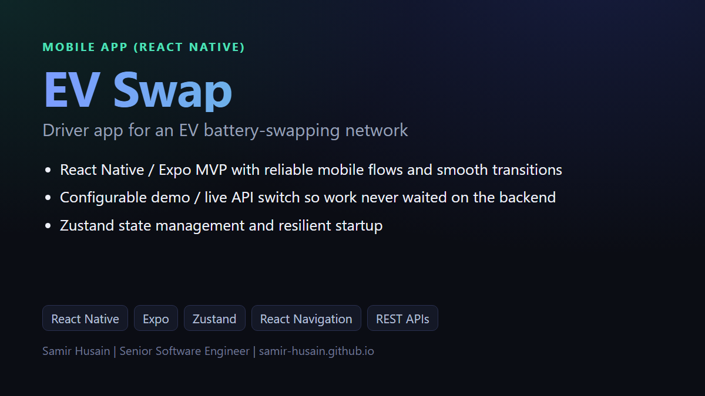
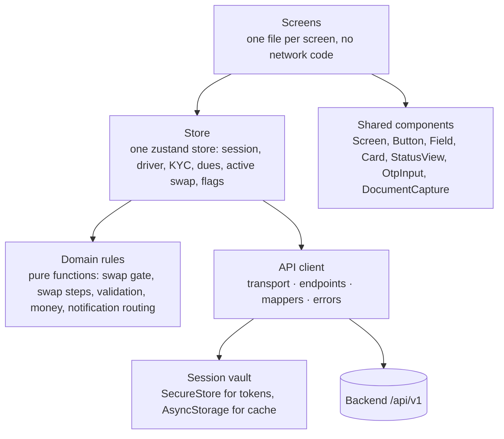
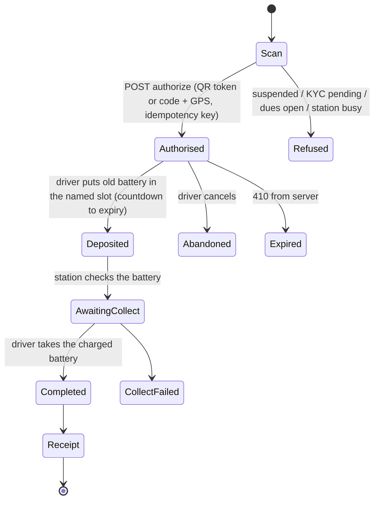

# EV battery-swap driver app: engineering case study

**A React Native (Expo) app for drivers of electric vehicles on a battery-swapping network: find a station, scan its QR code, follow a guided swap, see dues, receipts and history, complete KYC. Built to a written API contract, tested at every layer, and shipped as release builds.**

My role: lead frontend engineer for the app at IINVSYS (React Native, Expo SDK 57, React Native 0.86, React 19, plain JavaScript). Backend and station firmware were separate teams.

> The source code is proprietary to my employer. This repository documents the architecture and the engineering decisions, which I can discuss in depth in an interview. No internal hosts, tickets or contract documents are reproduced here.

## What the app does

- **Sign in / sign up** with phone and OTP, password reset, profile completion.
- **Stations**: nearby stations by GPS and radius, live station detail, "turn on location" and "station offline" states.
- **Swap**: scan the station QR (or type the code), authorise, then a guided flow: deposit the old battery in the named slot, wait for the check, collect the charged battery, receipt. Cancel before deposit; reopen the door if needed; recover the flow after a restart or a lost connection.
- **Dues and history**: outstanding energy charges, swap history, per-swap receipts (read-only by contract; no payment SDK in the app).
- **KYC**: PAN and Aadhaar numbers plus four photo captures, uploaded one by one, with status feeding the swap gate.
- **Notifications** (feed, preferences, in-app banners, push registration), **profile**, **help and support**, legal pages.

## Architecture

Dependencies point one way: screens use the store, the store uses the API client and the domain rules. Domain and mapper code never import React Native, which is why they run under plain `node --test` in milliseconds.

### The API client, in four files

| File | Responsibility |
|---|---|
| `endpoints` | One function per route, with the method, path, query and body shape. Comments cite the contract section. |
| `transport` | Bearer token; **single-flight refresh on 401** (parallel calls wait on the same refresh, and a call that lost the race retries with the new token); `Idempotency-Key` on every write; `problem+json` errors turned into typed errors; network failures collapsed into one "offline" error; server `Date` header kept as a clock offset so countdowns follow server time. |
| `mappers` | The only place that reads server JSON. Converts snake_case, integer paise and milli-units into app models; tolerates documented aliases. |
| `errors` | Each documented error code mapped to the driver-facing message. |

Money stays integer paise and energy integer milli-units end to end; formatting happens in exactly one domain module.

### The swap, as a state machine

- The store polls the swap every 2 seconds while the Swap screen is focused.
- The Swap screen cannot be dismissed by gesture and Android Back is blocked until an end state.
- An active swap is also stored on the phone, so after a restart or a late 401 the app reads the current swap from the server and rebuilds the screen at the right step.
- The **swap gate** (profile, KYC, dues, active swap) is computed on the phone so the driver learns why a swap is blocked *before* reaching the station; the server remains the authority and refuses with the same reasons.

### Session and security

- Access and refresh tokens live in the OS keystore (expo-secure-store); only non-secret metadata and a cached profile go to AsyncStorage; on web, tokens stay in memory.
- Sign-out and account deletion clear the vault; Android backup is off.
- KYC photos are re-encoded as JPEG (no camera or location metadata), uploaded, then deleted; leftovers are purged on start, sign-out and deletion. The KYC and capture screens block screenshots and screen recording.
- Nothing sensitive is ever logged: no tokens, passwords, PAN or Aadhaar values.
- Fixed test coordinates work only in development builds; release builds always use the real GPS fix.

### Offline and server-down

A network failure sets an `offline` flag and screens show "Showing saved data"; a 5xx sets `serviceIssue` and the banner reads "Service unavailable". Both clear on the next successful call. Push registration is best effort and degrades to the in-app feed where native modules are missing (Expo Go).

## Testing

| Layer | What runs | Count at release |
|---|---|---|
| Unit | domain rules, mappers, transport, error mapping, and the response examples from the API document | **243 tests** |
| API end-to-end | the real transport, endpoints and mappers against a steerable mock backend (sign-in, KYC, stations, full swap, dues, history, notifications, support, profile, failure modes) | **16 journeys** |
| Device | a runner that starts the mock and Metro, opens the app in Expo Go on an emulator or phone and walks 16 steps with PASS/FAIL and screenshots of failures | 16 steps |
| Live smoke | read-only checks against the real server; never creates or changes data | per environment |

The mock backend follows the contract and can be steered (KYC state, dues, station blocked, no charged battery, swap faults, expiry, 503, latency). It proves the app matches the contract; the live smoke test proves the server is reachable. Production code has no mock mode.

## Environments and builds

The backend address is chosen by the run command or the EAS build profile, never edited in code; a missing or misspelt environment falls back to development, never production. Local and cloud APK builds per environment; release builds require HTTPS.

## Design fidelity

Every screen was compared frame by frame against the Figma design (about 50 frames across onboarding, home, stations, scan and swap, dues, profile) and the result recorded as Match / Intended difference / Fixed / Gap, so product and engineering agreed on exactly what shipped.

## How I work on it

Contract first, then a test at every layer that can run without the real server, then a device run, then a frame-by-frame design comparison, then a written list of what was and was not verified live. The details, including the bugs that bit and what changed because of them, are in [`docs/quality.md`](docs/quality.md).

## Stack

React Native 0.86, Expo SDK 57, React 19, React Navigation, zustand, expo-secure-store, expo-camera, expo-location, expo-notifications, expo-file-system, `node --test`, EAS Build.

---

Samir Husain · [LinkedIn](https://www.linkedin.com/in/samir-husain1412/) · samirhusain.1412@gmail.com
